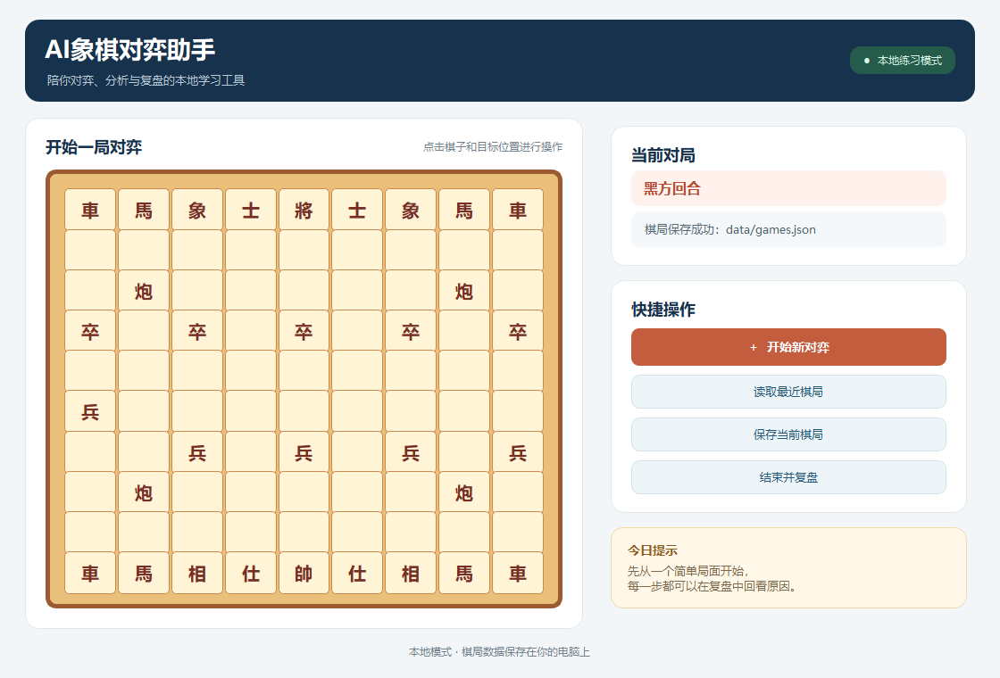
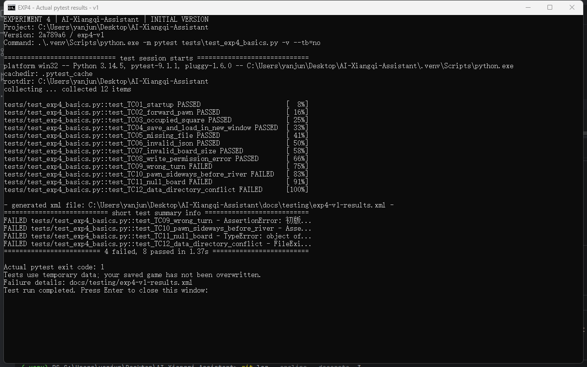
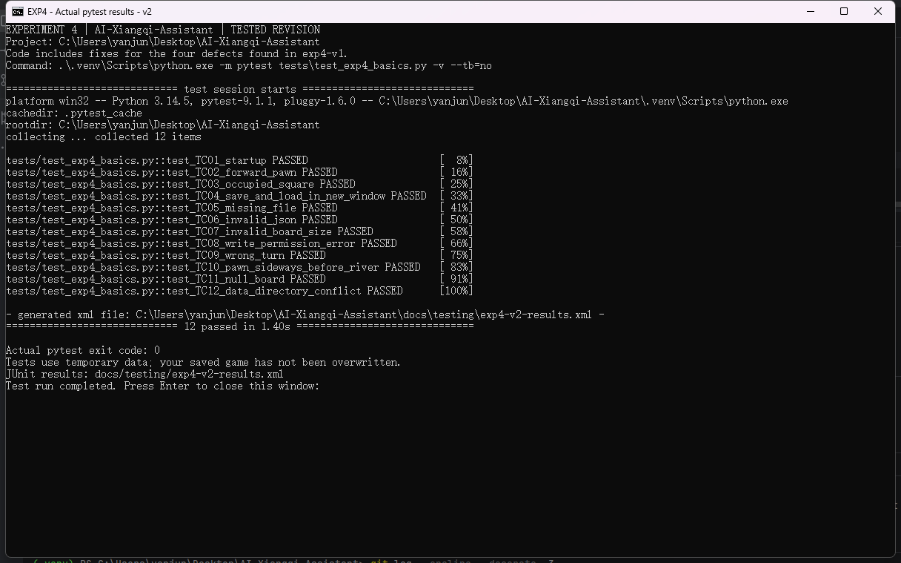
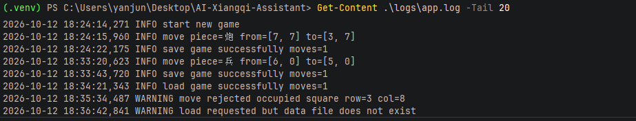
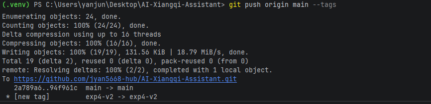

# 实验4：软件基础功能开发

**项目名称：** AI象棋对弈助手系统  
**班级：** 24级软件工程1班  
**学号：** 24111302009  
**姓名：** 闫俊  
**日期：** 2026年10月12日  
**仓库：** <https://github.com/jyan5668-hub/AI-Xiangqi-Assistant>

## 一、实验目标与项目范围

本实验围绕实验2的用户需求和实验3的架构设计，实现一个可运行的象棋基础练习版本，并按“可运行初版”和“测试修订版”完成两轮迭代。当前实现覆盖本地棋盘交互、基础走子、棋局 JSON 保存与读取、日志和错误提示；它是后续桌面 App 的工程基础，不是完整的 AI 象棋产品。

实验3确定的技术路线是 Python + PySide6 桌面界面、本地文件保存和模块化业务逻辑。本次沿用该路线，暂不增加服务端、账号或外部引擎依赖。当前版本没有接入象棋 AI 引擎，也没有实现将军、将死、重复局面和完整终局判断；界面如实标记为“本地练习模式”。后续再完成完整规则、引擎接入、复盘分析与 Windows 安装包。

## 二、迭代计划与版本

| 迭代 | 任务与完成条件 | 实际结果 | 版本证据 |
|---|---|---|---|
| 可运行初版 | 建立 PySide6 窗口和 10×9 棋盘；实现新局、基础走子、保存/读取入口；能启动并至少完成一次读写 | 已完成；首轮测试发现 4 个缺陷 | Commit `2a789a6`；Tag `exp4-v1` |
| 测试修订版 | 针对用例补充走棋方和基础棋子规则校验、存档格式检查、目录错误处理；同组用例复测全通过 | 已完成；12项通过、0项失败 | Commit `94f961c`；Tag `exp4-v2` |

`exp4-v1` 保留初版，`exp4-v2` 指向修订版。两个标签和 `main` 均已推送至 GitHub；报告编写时远程 `main` 与本地 `main` 同步。

## 三、项目结构与模块职责

| 路径 | 职责 |
|---|---|
| `app/main.py` | PySide6 主窗口、棋盘初始化、界面事件、基础走子校验、保存/读取和日志 |
| `tests/test_exp4_basics.py` | 12项可重复的基础功能与异常测试 |
| `docs/testing/exp4-v1-tests.md` | 用例说明、初版与修订版的结果对照 |
| `docs/testing/exp4-v1-console.txt`、`exp4-v2-console.txt` | 两次 pytest 控制台输出 |
| `docs/testing/exp4-v1-results.xml`、`exp4-v2-results.xml` | 两次测试的 JUnit XML 结果 |
| `data/games.json` | 本地棋局数据文件；运行时生成，已加入忽略规则，不提交真实个人棋局 |
| `logs/app.log` | 运行日志；记录新局、走棋、读写和被拒绝操作 |

本项目采用单机桌面结构：PySide6 界面接收用户点击并反馈状态，窗口内业务逻辑校验棋子和回合，文件模块以 JSON 持久化棋局，Python logging 将关键事件写入本地日志。该版本暂未拆成独立 Web 前后端或数据库服务，与实验3的本地优先设计一致。

## 四、核心数据与初始化

新局初始化为 10 行、9 列棋盘，包含双方各 16 枚棋子，共 32 枚；红方先行。空格以空字符串表示，棋子归属保存在同尺寸的 `sides` 矩阵中。

| 字段 | 类型/示例 | 用途 |
|---|---|---|
| `board` | 10×9 字符串矩阵 | 保存棋盘位置和棋子名称 |
| `sides` | 10×9 的红方 / 黑方 / `null` 矩阵 | 记录每个棋子的所属方 |
| `current_turn` | 红方 / 黑方 | 记录下一回合 |
| `moves` | 走棋记录数组 | 保存棋子、起点、终点和时间 |
| `saved_at` | ISO 日期时间字符串 | 记录最近保存时间 |

程序启动时由代码创建 `data/` 和 `logs/` 目录。棋局文件不存在时，读取操作显示“暂无历史对局”，不覆盖当前棋盘；保存成功后写入 `data/games.json`。读取前检查棋盘维度、单元格类型、棋子归属矩阵和走棋记录结构；写入时捕获文件系统错误并在界面提示。测试使用临时目录，不会覆盖用户自己的棋局。

## 五、基础业务闭环

核心流程对应实验2的快速练习需求和实验3的棋盘交互设计：

1. 用户启动程序，系统显示标准初始棋盘、32枚棋子和红方回合。
2. 用户点击红方棋子，再点击目标格；系统检查当前回合、目标格和已实现的基础棋子走法。
3. 合法移动后更新棋盘、棋子归属、走棋记录与回合状态，并在界面提示结果。
4. 用户点击“保存当前棋局”，系统把局面、走棋记录、当前回合和保存时间写入 JSON。
5. 用户之后可读取最近棋局；结束入口显示本局步数并记录日志。

修订版实测示例：红兵从坐标 `(6,0)` 移至 `(5,0)`，系统更新棋盘并切换为黑方回合，随后保存成功。界面截图见图1。坐标从0开始，采用（行，列）格式。



当前“结束并复盘”仅生成基础步数反馈，尚未计算棋力评价、关键失误或 AI 建议；报告不将该入口表述为完整复盘能力。

## 六、测试设计、初版结果与修订版复测

测试环境：Windows、Python 3.14.5、PySide6 6.12.0、pytest 9.1.1。测试通过以下命令执行：

```powershell
.\.venv\Scripts\python.exe -m pytest tests\test_exp4_basics.py -v --tb=short
```

同一组 12 项测试分别运行于初版和修订版。测试数据使用 pytest 临时目录，写入失败和损坏数据通过受控模拟产生。

| 编号 | 测试操作 | 初版 | 修复内容 | 修订版 |
|---|---|---|---|---|
| TC-01 | 启动并检查 10×9 棋盘、32枚棋子、红方先行 | 通过 | 无 | 通过 |
| TC-02 | 红兵向前移动一格 | 通过 | 无 | 通过 |
| TC-03 | 移动到本方棋子占据的格子 | 通过 | 无 | 通过 |
| TC-04 | 保存后在新窗口读取并比对棋局、回合和棋步 | 通过 | 无 | 通过 |
| TC-05 | 文件不存在时读取 | 通过 | 无 | 通过 |
| TC-06 | 读取损坏的 JSON | 通过 | 无 | 通过 |
| TC-07 | 读取尺寸错误的棋盘 | 通过 | 无 | 通过 |
| TC-08 | 模拟写入权限错误 | 通过 | 无 | 通过 |
| TC-09 | 红方回合尝试移动黑方棋子 | 失败：错误移动被接受 | 增加棋子所属方和回合检查 | 通过 |
| TC-10 | 红兵未过河时尝试横向移动 | 失败：错误移动被接受 | 增加兵卒基础移动方向与过河判断 | 通过 |
| TC-11 | 存档中的 `board` 为 `null` | 失败：出现未处理类型错误 | 加载前检查棋盘、行列、棋子和走棋记录类型 | 通过 |
| TC-12 | 数据目录被同名文件占用后尝试保存 | 失败：目录创建错误未处理 | 将目录创建和写入放入异常处理 | 通过 |

**结果：**初版 8 通过、4 失败；修订版 12 通过、0 失败。初版失败不是被忽略的“预期失败”，而是驱动本次修订的实际缺陷。图2和图3分别展示两轮的控制台结果，详细输出和 JUnit 文件位于 `docs/testing/`。





## 七、异常处理与日志

| 情况 | 程序处理 | 可核验记录 |
|---|---|---|
| 读取文件不存在 | 提示尚无历史棋局，保留当前局面 | TC-05、`logs/app.log` |
| JSON 损坏、棋盘维度或字段类型错误 | 提示读取失败，保留当前棋局 | TC-06、TC-07、TC-11 |
| 错误回合、走法或目标格 | 拒绝操作，不追加棋步；状态栏说明原因 | TC-03、TC-09、TC-10；日志记录 warning |
| 保存目录或文件不可写 | 提示保存失败，内存棋局保持不变 | TC-08、TC-12；异常日志记录堆栈 |

日志文件位于 `logs/app.log`，格式包含时间、级别和操作摘要。图4展示本地运行中的新局、走棋、保存、读取及拒绝操作记录。日志与棋局文件均在本机，不上传用户数据。



## 八、AI辅助编码审查记录

| 审查项 | 记录 |
|---|---|
| AI 辅助任务 | 搭建可运行的 PySide6 象棋界面，补充本地棋局保存/读取与异常处理，并根据测试失败修正基础功能 |
| 采用的建议 | 使用 JSON 保存局面和走棋记录；保存/读取状态在界面反馈；对走棋方、棋盘结构和文件系统错误进行显式校验 |
| 初稿发现的问题 | 初版未阻止错误回合移动和未过河兵横走；`board=null` 会引发类型异常；数据目录冲突会导致未处理错误。上述问题由 TC-09 至 TC-12 重现 |
| 人工核验依据 | 以实验2的基本操作需求、实验3本地保存设计及 12 项可重复测试核验行为；比对初版/修订版控制台输出、测试截图和代码差异 |
| 修订后验证 | 同组 12 项用例全部通过；检查保存/读取、失败提示和棋盘保持行为；保留两版 Commit、Tag、日志和结果文件 |
| 未采纳/限制 | 不把界面标签写成“引擎就绪”，不声称已经实现 AI 对弈或完整复盘；将状态改为“本地练习模式”。象棋完整规则需后续接入经过验证的规则库或继续补充测试 |

AI 生成的代码没有直接视为正确答案。初版测试暴露问题后，先定位失败场景，再修改并复测。修订版仍未覆盖将军、将死、长将/重复局面、所有特殊边界以及真正引擎计算，因此“12项通过”仅表示本报告所列范围通过，不代表象棋规则完整。

## 九、仓库版本与文件证据

| 内容 | 仓库路径/Commit |
|---|---|
| 初版可运行程序 | `app/main.py`，Commit `2a789a6`，Tag `exp4-v1` |
| 修订版程序与测试 | `app/main.py`、`tests/test_exp4_basics.py`，Commit `94f961c`，Tag `exp4-v2` |
| 初版测试说明与结果 | `docs/testing/exp4-v1-tests.md`、`docs/testing/exp4-v1-console.txt`、`docs/testing/exp4-v1-results.xml` |
| 修订版测试结果 | `docs/testing/exp4-v2-console.txt`、`docs/testing/exp4-v2-results.xml` |
| 实验截图 | `docs/evidence/exp4/` |
| 本报告 Markdown | `docs/reports/实验4-软件基础功能开发.md` |

仓库地址：<https://github.com/jyan5668-hub/AI-Xiangqi-Assistant>。修订版推送截图见图5。提交记录可通过仓库网页的 Commits 页面和 `exp4-v1`、`exp4-v2` 标签核验。



## 十、截图与操作记录

| 图号 | 截图文件 | 说明 |
|---|---|---|
| 图1 | `docs/evidence/exp4/v2-game-save.png` | 修订版程序实际启动后，完成红兵走子并保存；展示本地练习状态、棋盘更新、黑方回合和保存成功提示 |
| 图2 | `docs/evidence/exp4/v1-12-test-results.png` | 初版同组 12 项测试结果：8通过、4失败 |
| 图3 | `docs/evidence/exp4/v2-12-test-results.png` | 修订版同组 12 项测试结果：12通过、0失败 |
| 图4 | `docs/evidence/exp4/v1-log-output.png` | 本地应用日志示例，包含新局、走棋、保存/读取和拒绝操作记录 |
| 图5 | `docs/evidence/exp4/v2-github-push.png` | 推送输出，显示 `main` 更新到 `94f961c` 且 `exp4-v2` 标签推送成功 |

操作记录：先检查初版可运行性并执行 12 项测试；根据 4 项失败补充校验和错误处理；再次执行同一测试集；运行修订版应用验证走子与保存；最后推送 `main` 和实验标签至 GitHub。所有截图均对应程序运行、测试或实际版本操作，没有用静态页面代替测试结果。

## 十一、实验小结

本次实验完成了从可运行桌面骨架到测试修订版的迭代闭环：使用 PySide6 完成棋盘和操作入口，以 JSON 保存本地棋局，以日志记录关键业务事件，并用同一组 12 项测试对比修复前后的结果。初版的 4 个真实问题都对应到测试用例，修订版复测全部通过；两个版本分别以 Commit 和 Tag 保留，便于追溯。

目前交付适合作为后续功能开发起点，不能替代完整象棋软件。下一阶段应补足完整合法性与终局规则，接入中国象棋引擎，实现真正的人机对弈和基于对局数据的复盘，最后再验证并打包为 Windows App。报告与截图用于本次实验过程核验，最终学习通只按实验要求提交命名后的 PDF。
